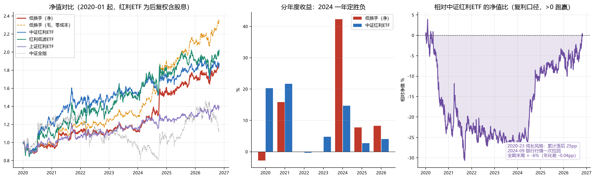

# 低换手 vs 红利基准 + 样本区间审计

日期：2026-11-02　数据截至：2026-10-30（红利 ETF 至 2026-11-02）

---

## 0. 一句话结论

1. **该比红利，而且比完结论要改**：低换手与中证红利 ETF 全期年化打平（10.02% vs 10.06%），
   超额信息比率 −0.05；跟红利低波 ETF 比还输 1.35pp。它不是 alpha 策略，
   是「更集中、更低波的红利组合」——优势在波动和回撤，不在收益。
2. **收益高度依赖 2024 一年**：2024 低换手 +42.3%，红利 +14.7%；剔除 2024-09-24 起那 6 个交易日，
   全期年化掉到 6.65%，反而跑输红利 0.65pp。
3. **样本不是两年，也没有"用两年训练"**：五条腿里只有主策略有训练，而且是
   **滚动 3 年、每 12 周重估**；低换手/ETF/板块/转债是零训练规则策略。
   真正的样本问题在别处 —— **回测起点和四侧权重都是挑过的**，这才是隐性过拟合。

---

## 1. 为什么必须换基准

之前所有报告拿**中证全指**做基准（低换手 10.02% vs 中证全指 1.92%，看起来赢 8pp）。
这个比法是错的，两个原因：

| 问题 | 后果 |
|---|---|
| 中证全指不做任何红利筛选 | 基准里 90% 是跟策略无关的成长/周期股 |
| 指数是**价格指数，不含股息** | 红利类标的股息率 4~6%，等于让基准每年少 5pp |

低换手的持仓是四大行 + 中石油 + 人寿 + 公用事业，**它本质就是个红利组合**。
拿不含股息的全指去比，超额里至少一半是"股息没算进基准"。

正确的做法：用**红利 ETF 的后复权价**（含分红再投资），这才是投资者真能拿到的收益。

### 1.1 数据来源与踩的坑

新增 `scripts/build_div_panel.py`，落盘 `build/etf/div_panel.parquet`：

| 代码 | 名称 | 起始 | 用途 |
|---|---|---|---|
| 515080 | 中证红利ETF | 2019-12-27 | **主基准**（与策略选股逻辑最接近） |
| 512890 | 红利低波ETF | 2019-01-18 | 次基准（低波维度） |
| 510880 | 上证红利ETF | 2007-01-18 | 最长样本（但只覆盖沪市） |
| 000922 | 中证红利 | 2008-08-04 | 价格指数，仅参考 |
| H30269 | 红利低波 | 2013-12-19 | 价格指数，仅参考 |

**踩坑记录（重要，以后别再犯）**：
腾讯 `newfqkline` 的 `qfq` 是「以最新价为基准」的前复权，**分段抓取每段基准不同**，
拼起来会出现阶梯跳变 —— 第一次抓出来 510880 是 vol 454%、最大回撤 −107%，
000922 单日 −19.3%。改用东方财富 `push2his`（一次返回全历史 + `fqt=2` 后复权）后数据连续。

**价格指数不能当基准**：000922 价格指数 2020-2026 年化只有 3.36%，而中证红利 ETF
后复权是 10.06% —— 差 6.7pp，全是股息。任何拿价格指数算超额的报告都会系统性虚高。

---

## 2. 结果

### 2.1 全区间（2020-01-02 ~ 2026-10-30，82 个月）

| 组合 | 年化 | 波动 | Sharpe | 最大回撤 | Calmar | 月胜率 |
|---|---|---|---|---|---|---|
| **低换手（净）** | **10.02%** | **11.57%** | **0.754** | **−12.70%** | 0.79 | 57.3% |
| 低换手（毛，零成本） | 14.03% | 11.54% | 1.065 | −12.43% | 1.13 | 57.3% |
| 中证红利ETF | 10.06% | 15.16% | 0.610 | −17.23% | 0.58 | 54.9% |
| 红利低波ETF | 11.36% | 17.04% | 0.629 | −16.53% | 0.69 | 53.7% |
| 上证红利ETF | 5.32% | 12.23% | 0.363 | −15.34% | 0.35 | 54.9% |
| 中证红利（价格） | 3.36% | 17.01% | 0.192 | −20.97% | 0.16 | 52.4% |
| 红利低波（价格） | 4.46% | 17.04% | 0.253 | −17.54% | 0.25 | 52.4% |
| 中证全指 | 1.92% | 20.35% | 0.122 | −39.33% | 0.05 | 54.9% |

**读法**：
- vs 中证红利ETF：年化差 **−0.04pp**（打平），Sharpe 高 0.14 —— 全部来自波动更低（11.6% vs 15.2%）。
- vs 红利低波ETF：年化**输 1.35pp**，Sharpe 反而高 0.13 —— 同样是低波的功劳。
- 上证红利ETF 只有 5.32%，因为它只选沪市 50 只、偏钢铁煤炭交运，2020 年那波完全错过。
  **不要拿它当红利基准**，会虚增 4.7pp 超额。

### 2.2 相对基准的超额分解

| 基准 | 相关 | beta | 年化超额 | 跟踪误差 | IR | 日胜率 |
|---|---|---|---|---|---|---|
| 上证红利ETF | 0.709 | 0.67 | +4.28% | 9.10% | +0.47 | 49.9% |
| **中证红利ETF** | **0.704** | **0.54** | **−0.52%** | 10.80% | **−0.05** | 47.8% |
| 红利低波ETF | 0.742 | 0.50 | −2.00% | 11.47% | −0.17 | 51.6% |

相关性 0.70~0.74、beta 0.50~0.54 —— **一半以上是红利 beta，剩余部分是更集中的银行暴露**。
IR 全部在 0 附近或为负：**没有独立信息**。

### 2.3 分年度：2024 一年定胜负

| 年份 | 低换手(净) | 低换手(毛) | 上证红利ETF | 中证红利ETF | 红利低波ETF |
|---|---|---|---|---|---|
| 2020 | −2.77% | −0.07% | −1.42% | **+20.30%** | +8.14% |
| 2021 | +15.85% | +20.04% | +7.87% | **+21.67%** | +19.73% |
| 2022 | −0.10% | +3.73% | +1.92% | −0.32% | +2.89% |
| 2023 | +0.06% | +3.67% | +5.30% | +4.79% | **+11.74%** |
| 2024 | **+42.30%** | +47.00% | +13.47% | +14.68% | +22.98% |
| 2025 | +7.77% | +11.78% | −0.56% | +2.76% | +4.63% |
| 2026 | +8.30% | +11.55% | +9.10% | +4.03% | +5.70% |

**2020-2023 四年里有三年跑输中证红利**（2020 输 23pp、2021 输 5.8pp、2023 输 4.7pp，
2022 基本打平），累计落后 25pp；2024 一年拉回 28pp，后面 2025/2026 继续小幅领先。

### 2.4 分区间（策略在不同窗口的表现）

| 区间 | 低换手 | 中证红利ETF | 红利低波ETF | 中证全指 |
|---|---|---|---|---|
| 全区间 2020-01 起 | 10.02% / 0.754 | 10.06% / 0.610 | 11.36% / 0.629 | 1.92% / 0.122 |
| **样本外 2022-01 起** | **11.53% / 0.895** | 5.29% / 0.337 | 9.73% / 0.569 | — |
| 近 3 年 2023-11 起 | 18.43% / 1.403 | 6.89% / 0.468 | 10.90% / 0.662 | — |

**这是对策略最有利的一张表**：2022 起（红利风格占优的四年）低换手年化 11.53%，
跑赢红利 6.2pp、跑赢红利低波 1.8pp，且回撤只有 −8.9%（红利 −12.3%）。

### 2.5 但代价是：超额全在 6 个交易日里

| 检验 | 结果 |
|---|---|
| 2024-09-24 ~ 10-08（6 个交易日） | 低换手 +20.56%，红利 +15.91%，超额 +3.98% |
| **剔除这 6 天** | 低换手年化 **6.65%**，红利 7.30%，**跑输 0.65pp** |
| 全期相对净值末尾 | ≈ −6%（年化差 −0.04pp） |



第三张图最直白：2020-2023 相对净值一路下沉到 −25%，2024-09 一根近乎垂直的线拉回 0 附近。
**"年化打平"不是一个稳定跑出来的结果，是两个相反风格期的抵消。**

---

## 3. 它到底买的是什么

82 期持仓频率（共 820 个持仓位）：

| 代码 | 名称 | 次数 | 占比 | 行业 |
|---|---|---|---|---|
| 601988 | 中国银行 | 78 | 95% | 银行 |
| 601398 | 工商银行 | 73 | 89% | 银行 |
| 601288 | 农业银行 | 69 | 84% | 银行 |
| 601857 | 中国石油 | 68 | 83% | 石油石化 |
| 601628 | 中国人寿 | 68 | 83% | 非银 |
| 601998 | 中信银行 | 57 | 70% | 银行 |
| 600236 | 桂冠电力 | 36 | 44% | 公用事业 |
| 600018 | 上港集团 | 31 | 38% | 交运 |
| 600000 | 浦发银行 | 31 | 38% | 银行 |
| 601018 | 宁波港 | 26 | 32% | 交运 |

银行只数占比：均值 38%、中位 40%。**这就是一个「四大行 + 中特估」组合。**

### 3.1 和"买四大行不动"比

| 组合 | 年化 | 波动 | Sharpe | 最大回撤 | Calmar |
|---|---|---|---|---|---|
| 低换手（净） | 10.02% | 11.57% | 0.754 | −12.70% | 0.789 |
| 四大行等权买入持有 | 9.56% | 10.71% | **0.766** | **−10.74%** | **0.890** |

相关 0.644、beta 0.695；**净超额 +0.51%/年，IR 0.054**。

**每月调仓 + 付 49bp 成本，换来的是 +0.5pp/年、IR 0.05。** 而毛口径下低换手 14.03% vs
四大行 9.56%，差 4.5pp —— 也就是说：**换仓确实有 4.5pp 的毛 alpha，
但被 4.0pp 的交易成本正好吃掉**。

> 注：四大行不是事后挑的，是策略自己 82 期里选出频率最高的 4 只，可以看作
> "策略平均持仓的静态版"。这个对照回答的是：**换仓这个动作本身值不值钱。**

---

## 4. 第二个问题：样本内到底是多久？训练基于哪两年？

### 4.1 先纠正一个可能的误解

项目里的三段切分（`qf/config.py`）是：

| 阶段 | 区间 | 长度 | 用途 |
|---|---|---|---|
| `DEV` 研究期 | 2017-01-01 ~ 2019-12-31 | **3 年** | 因子族判断、超参数选择、**真正的样本内** |
| `VALID` 验证期 | 2020-01-01 ~ 2021-12-31 | **2 年** | 走查验证 |
| `TEST` 样本外 | 2022-01-01 起 | 4.8 年 | 最终报告口径 |

你说的"两年"应该是 **VALID 验证期 2020-2021**。它是**验证**用的，不是训练用的。

### 4.2 五条腿的实际训练情况

| 策略 | 类型 | 参数怎么来的 | 回测区间 | 用了多少历史数据 |
|---|---|---|---|---|
| **主策略 wf_h10** | 因子模型 | ① 因子池：**只用 2017-2019** 的周频 ICIR + 覆盖率 + 相关性剪枝选出，**选出后冻结**；② 权重：每 12 周用**截至当时的滚动 3 年（156 周）**重估 | 2020-01-08 ~ 2026-10-30 | 滚动 3 年 + 3 年定池 |
| **低换手** | 规则 | 你口述的规则（20 日换手、最小 10 只、ST/退市/停牌/上市 1 年过滤），**没有调过参** | 2020-01-02 起（面板可回溯到 2017-11） | **零训练** |
| **宽基 ETF 趋势** | 规则 | 55 日新高突破（人工设定） | 2013 起 | **零训练** |
| **板块 ETF 轮动** | 规则 | 突破 55 日 / 动量 60 日 / 前 3 / 10 日调仓（v3，"参数高原中心"） | 2019 起 | **零训练，但参数网格选过** |
| **可转债** | 规则 | 双低/动量阈值 | — | **零训练** |

**结论：不存在"所有策略都用那两年训练"这回事。** 五条腿里四条根本没有训练环节，
唯一有训练的主策略是滚动 3 年、每季度换权重，而且因子池在 2019 年底就冻死了。

### 4.3 但真正该担心的问题在这里

零训练 ≠ 没有过拟合。下面三件事都是**在同一段历史上挑出来的**：

| 隐性挑参 | 证据 | 影响 |
|---|---|---|
| **低换手回测起点选 2020** | 起点 2020-01：10.02% / Sharpe 0.754<br>起点 2018-01：**8.20% / 0.597**<br>起点 2017-11（数据最早可算）：**7.71% / 0.56** | 2020 起点比最早可算起点高 2.3pp/年 |
| **四侧权重 40/30/20/10** | 66 组网格扫描，全部在 2020-2026 上比较 | 有明确的挑参嫌疑；当时为避免挑尖峰选了次优而非最优（最优 30/35/25/10 Sharpe 0.9425） |
| **板块轮动 v3 参数** | 注释写"位于参数高原中心"，即做过网格 | 参数是选的，只是选了高原而非尖峰 |

**这意味着**：低换手报 10.02% 时，诚实的说法应该是
**"2020 起 10.02%（同期红利 10.06%），2018 起 8.20%"**，
而不是一个孤零零的 10%。

---

## 5. 建议

### 5.1 对低换手策略的定位要改

现在的定位是"月度低换手 alpha 策略"，30% 仓位。按上面的证据，它应该被重新定义为：

**「低波红利替代品」—— 一个更集中、波动更小、回撤更浅的红利组合，不是 alpha 源。**

两种处置：

| 方案 | 做法 | 代价 |
|---|---|---|
| **A. 保留但降权**（推荐） | 权重 30% → 15%，把 15% 让给红利低波 ETF | 放弃"选股"的想象，换更稳的执行 |
| **B. 保留现状** | 维持 30%，但报告和页面必须写清"vs 红利 ETF 无超额" | 承担风格反转时的持续跑输（2020-2023 落后 25pp 是真实发生过的） |

### 5.2 必须补的三件事

1. **所有涉及低换手的报告/页面，基准从"中证全指"改成"中证红利 ETF"** —— 现在的 8pp 超额是虚假的。
2. **回测起点改为 2018-01**（数据允许的最早），并在报告里同时给 2018 与 2020 两个口径。
   10.02% 只在 2020 起点成立。
3. **四侧权重在 2022+ 样本外重算一遍** —— 现在这组权重是 2020-2026 全区间扫出来的，
   含 2020-2021 的训练期信息。

### 5.3 不建议做的事

- 不要因为"2022 起跑赢 6pp"就加仓 —— 这段赢是因为红利/银行风格占优，
  2020-2021 同样风格的相反面亏了 25pp，两头都发生过。
- 不要用上证红利 ETF 当基准（它只有 5.32%，虚增超额）。

---

## 6. 复现方式

```bash
# 抓红利 ETF / 指数（东财 push2his，后复权）
python scripts/build_div_panel.py

# 对比表（默认 2020 起；--start 2018-01-02 看长样本）
python scripts/div_compare.py
python scripts/div_compare.py --start 2018-01-02

# 三联图
python scripts/plot_lowturn_vs_div.py
```

产物：
- `build/etf/div_panel.parquet`
- `build/eval/lowturn_vs_div.json`
- `reports/shots/低换手_vs_红利.png`

---

## 7. 顺带修的两个真问题

做这次对比时发现，页面数字与报告数字长期不一致，根因是**同一套策略有两份回测实现**。

### 7.1 双实现漂移

| | `build/exp_lowturn.py`（旧） | `qf/lowturn.py`（正式） |
|---|---|---|
| 跨月衔接 | 每月从 `cap0=1.0` 重新起算，**丢掉 82 次跳空** | 份额账本连续 `last_close` 承接 |
| 换仓成本 | 对全组合按 `1-(1-keep)·c` 近似打折 | 只对实际成交的份额计费 |
| 严格口径 | 独立一条 nav | 独立账本 |
| 净收益 | **9.84%** | **10.02%** |
| 最大回撤 | **−10.68%** | **−12.70%** |

`qf/lowturn.py` 修完 bug 后，`exp_lowturn.py` 没跟着改，而页面读的是 `build/runs/lowturn/`
（旧实现的产物）→ **报告写 10.02%、页面显示 9.84%**，回撤也不一致。

**处置**：`build/exp_lowturn.py` 重写为 `qf.lowturn.backtest()` 的**薄封装**，
只负责把结果写成 `build/runs/lowturn/{result,nav,picks,trades}`。
现在只有一份回测逻辑。同时 `services.py` 的 `strict_cagr` 改读新字段 `perf_strict`
（旧逻辑把 `perf_net` 当严格口径，导致页面「严格全换」显示成 10.02% 而不是 0.54%）。

### 7.2 页面基准表加了红利行

`GET /api/monthly_recommend` 的 `bench` 现在固定带三条：中证全指 / 全A等权 / **中证红利ETF**。
「本月推荐」页的「分年度与基准」表会直接显示：

| 基准 | 年化 | Sharpe | 回撤 |
|---|---|---|---|
| 中证全指 | 1.92% | 0.12 | −39.3% |
| 全A等权 | 8.11% | 0.39 | −32.6% |
| **中证红利ETF** | **10.06%** | **0.61** | **−17.2%** |

配合 KPI 里的「回测年化 10.02% / Sharpe 0.75」，**一眼能看出收益打平、波动更小**，
不会再被「赢中证全指 8pp」误导。

### 7.3 页面文案同步

- 「本月推荐」策略说明：补「对着红利比，不是对着全指比」一条；
  更新过期的 9.8%/18.5%（2024 实际 +42.3%）、严格口径 0.7% → 0.5%；
  新增「起点敏感」一条（2020 起 10.02% vs 2018 起 8.20%）。
- 「今日推荐」折叠说明：低换手 9.84% → 10.02%，并写明 vs 红利 ETF 无超额。

### 7.4 测试

`tests/test_monthly_recommend.py` / `test_lowturn.py` / `test_today_recommend.py` /
`test_web.py` 共 39 项通过；服务已在 8765 重启，`/api/monthly_recommend` 返回
`cagr=0.1002 / strict=0.0054 / gross=0.1403`，bench 含 `div_etf`。
