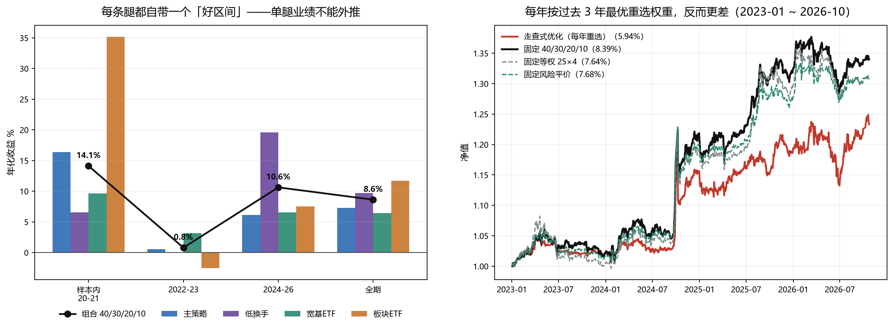
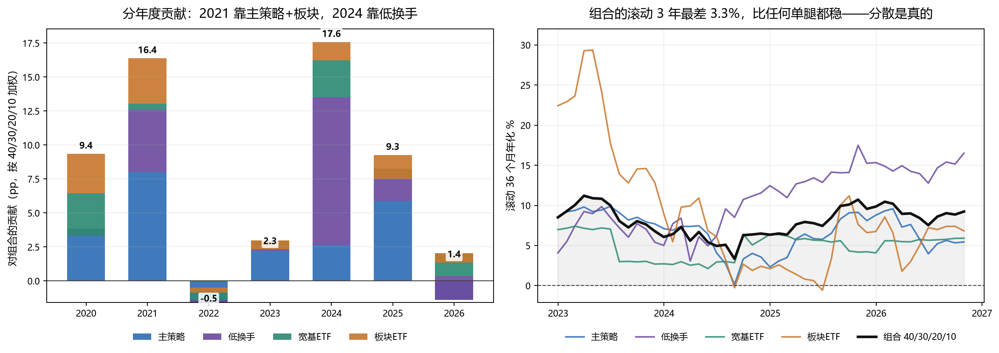

# 四侧权重要不要重估 —— 样本外检验

**日期**：2026-11-02　**区间**：2020-01-09 ~ 2026-10-23（四腿对齐后 1643 个交易日）

---

## 0. 结论先说

**不改。40% 主策略 / 30% 低换手 / 20% 宽基 ETF / 10% 板块 ETF 保持原样。**

不是因为找不到"更好的"权重——恰恰相反，样本外（2022+）的网格最优点是 **0/60/40/0**，
比现在的 6.42% 高出 4.59pp。**而是因为这个"更好"事后才算得出来、事前一算就亏。**

三条硬证据：

| 检验 | 结果 |
|---|---|
| 五个区间的网格最优组合 | 五个区间五个不同答案，四个在角落（全押某一条腿） |
| 每年按过去 3 年最优重选权重 | 年化 **5.94%**，比不动的 8.39% 低 **2.44pp** |
| 剔除 2024 一年后重算 | 所有候选权重的差距**全部消失**（6.1%–6.9%） |

还有一条顺带修正我自己的预判：**分散是真的有效的**，
组合的滚动 3 年最差 +3.33%，比任何单腿的最差都好。

---

## 1. 方法：为什么不能"在 2022+ 再扫一遍"

上一轮定权重（45/25/20/10 → 40/30/20/10）的依据是"2023-2026 从 5.65% 提到 8.36%"。
那已经是用样本外做决策了。如果这次再"在 2022+ 上扫一遍挑最优"，就是同一个错误的第二次。

所以这次不用"找最优点"，改用三个能证伪的方法：

1. **全网格 × 多区间**：1771 组（5% 步长），五个区间各扫一遍，看最优解会不会变；
2. **走查（walk-forward）**：每 12 个月只用"当时能看到的过去 36 个月"重选权重，持有 12 个月。
   这条是决定性的——它模拟的是"真的照着做"会怎样；
3. **剔除幸运年**：把每条腿最好的一年拿掉再算，看结论还成不成立。

---

## 2. 证据一：五个区间，五个角落

| 区间 | 网格最优权重（主/低/宽/板） | Sharpe | 当前 40/30/20/10 的排名 |
|---|---|---|---|
| 全期 2020-2026 | 20/30/45/5 | 0.964 | 第 89 百分位 |
| 样本内 2020-21 | 50/0/40/10 | 2.041 | 第 60 |
| 样本外 2022+ | **0/60/40/0** | 0.905 | 第 69 |
| 2022-23 | **0/0/100/0** | 0.787 | 第 59 |
| 2024-26 | **0/95/5/0** | 1.461 | 第 71 |

五个区间的最优解没有一对相似：分别是"重仓 ETF+少量板块""不要低换手""全押 ETF""六成低换手"
"九成半低换手"。**唯一稳定的信息是：最优解永远在角落**——Sharpe 最大化不带约束，一定跑到某条腿上。

而当前 40/30/20/10 在每个区间都落在第 59–89 百分位，**从未掉到后半区**。
它不是一个尖峰，是一片高原上的中上位置。



左图是同一件事的直观版：每条腿都自带一个"好区间"。
板块 ETF 在 2020-21 年化 35.2%，2022-23 是 **−2.6%**；低换手反过来，2020-21 只有 6.5%，
2024-26 是 19.6%。**单腿业绩不能外推，是这套组合的第一性事实。**

---

## 3. 证据二：走查优化跑不过"不动"

每年初用过去 36 个月 Sharpe 最优的权重，持有一年：

| 决策日 | 训练窗 | 选出权重 | 训练期 Sharpe | 次年实现 |
|---|---|---|---|---|
| 2023-01-03 | 2020-01~2022-12 | 25/0/60/15 | 1.440 | **2.40%** |
| 2024-01-02 | 2021-01~2023-12 | 30/5/60/5 | 0.861 | 13.23% |
| 2025-01-02 | 2022-01~2024-12 | 0/65/35/0 | 1.005 | **3.85%** |
| 2026-01-05 | 2023-01~2025-12 | 25/75/0/0 | 1.260 | **4.31%** |

看第二列和第五列的关系：**训练期 Sharpe 高的，次年都不行**。
2023 年训练出 1.44 的漂亮 Sharpe（因为 2020-22 板块和 ETF 好），照着做，次年只有 2.40%。

2023-01 ~ 2026-10 的实际结果：

| 方案 | 年化 | 波动 | Sharpe | 回撤 |
|---|---|---|---|---|
| **走查式优化（每年重选）** | **5.94%** | 8.16% | 0.564 | −8.50% |
| **固定 40/30/20/10** | **8.39%** | 7.95% | **0.864** | **−6.82%** |
| 固定等权 25×4 | 7.64% | 8.85% | 0.706 | −7.90% |
| 固定风险平价 | 7.68% | 7.84% | 0.791 | −7.02% |
| 固定全押低换手（事后最优） | 14.13% | 11.09% | 1.112 | −8.87% |
| 固定全押主策略 | 6.02% | 10.29% | 0.474 | −12.63% |

**优化 −2.44pp。** 而且加约束也救不回来，规律是"优化得越少越好"：

| 做法 | 年化 | Sharpe |
|---|---|---|
| 纯优化（100% 听历史的） | 5.94% | 0.564 |
| 70% 优化 + 30% 等权 | 6.48% | 0.636 |
| 50% 优化 + 50% 等权 | 6.83% | 0.671 |
| 30% 优化 + 70% 等权 | 7.16% | 0.694 |
| 纯等权（完全不听历史） | 7.64% | 0.706 |
| 限制单腿 ≤50% 的优化 | 5.27% | 0.514 |
| **固定 40/30/20/10** | **8.39%** | **0.864** |

单调递增到"完全不听历史"为止，但仍然追不上一个预先定死的 40/30/20/10。

**诚实交代一层偏袒**：固定 40/30/20/10 的 8.39% 有偏袒——这个权重是在包含 2023-2026 的全期上挑的。
但即使把这层偏袒全算给它，走查版 5.94% 也**低于完全无参数的等权 7.64% 和风险平价 7.68%**。
所以"动态优化没有价值"这个结论不依赖那层偏袒。

---

## 4. 证据三：所有优势都来自 2024 一年

这是整份报告最该看的一张表。把 2024 年（低换手 +42.3%，主策略 +6.0%）扣掉再算：

| 方案 | 全期 | 剔除 2024 | 剔除 2024&2020 | 2022+ 剔除 2024 |
|---|---|---|---|---|
| **40/30/20/10（当前）** | **8.62%** | **6.87%** | 6.23% | 3.27% |
| 30/40/20/10（多配低换手） | 8.86%（+0.24pp） | 6.59%（**−0.28pp**） | 6.17% | 3.33% |
| 低换手 100% | 9.68%（**+1.06pp**） | 4.59%（**−2.28pp**） | 6.16% | 3.59% |
| 主策略 100% | 7.31%（−1.31pp） | 7.48%（+0.61pp） | 6.88% | 3.09% |

三件事：

1. **"低换手权重加到 40%"的全部好处（+0.24pp）在剔除 2024 后变成 −0.28pp**；
2. **"全押低换手"的全期优势 +1.06pp，剔除 2024 后是 −2.28pp**——纯粹一年；
3. **剔除 2024&2020 两个极端年份后，四个方案落在 6.16%–6.88%，差距不到 0.7pp。**

第 3 条是关键：**权重之争在拿掉幸运年份后就不存在了**。
四条腿真正稳定的年化都在 4.5%–5% 附近，组合 6.2% 的差异主要来自"谁在哪一年撞上了行情"。

顺带一提，第 4 列也解释了为什么主策略"看起来差"：它被 2024 的低换手比下去了。
扣掉 2024，主策略 7.48% 反而高于组合的 6.87%。**没有哪条腿是真的差，只有"上一年谁最好"在变。**

---

## 5. 证据四：分散是真的（修正我前面的话）

我一开始的判断是"四条腿各自靠某一年撑着，分散是假的"。这个判断**错了**，滚动窗口把它否掉了。

各腿滚动 36 个月年化（47 个窗口）：

| | 正收益窗口占比 | 中位 | 最差 |
|---|---|---|---|
| 主策略 | 100% | 7.30% | 0.15% |
| 低换手 | 100% | 11.16% | 3.06% |
| 宽基 ETF | 100% | 5.60% | 2.13% |
| 板块 ETF | 96% | 6.99% | **−0.57%** |
| **组合 40/30/20/10** | **100%** | 8.04% | **3.33%** |

**组合的"最差 3 年"是 +3.33%，高于任何一条单腿的最差 3 年。** 这是分散有效的定义式证据。

分年度贡献也印证这一点——每年谁挑大梁都在换：

| 年 | 主策略 | 低换手 | 宽基ETF | 板块ETF | 合计 |
|---|---|---|---|---|---|
| 2020 | +3.84 | −0.53 | +3.14 | +2.90 | +9.37 |
| 2021 | +8.02 | +4.59 | +0.44 | +3.33 | +16.39 |
| 2022 | −1.57 | +0.16 | +0.55 | +0.37 | −0.49 |
| 2023 | +2.20 | +0.14 | +0.65 | −0.66 | +2.33 |
| 2024 | +2.63 | **+10.88** | +2.71 | +1.37 | +17.58 |
| 2025 | +5.88 | +2.38 | −0.75 | +1.77 | +9.27 |
| 2026 | −1.40 | +1.76 | +1.69 | −0.68 | +1.36 |

所以正确的说法是：**不是"每条腿都稳"，而是"四条腿的坏年份错开了"。**
这正是分散该有的样子，也意味着不该去追"当下最好的那条腿"——那恰好会破坏这个错位。



---

## 6. 落地建议：把权重从"参数"改成"制度"

既然重估没有用，那就要防止"以后看到某条腿变差就想动"。做法是给每条腿一个容忍带：
**只在越界时才调整，且必须用全期口径判断，不能用最近 3 年。**

各腿权重从 0 扫到 95%（其余三腿按原比例缩放），取 Sharpe ≥ 峰值 95% 的区间：

| 腿 | 当前 | 全期口径容忍带 | 样本外口径容忍带 | 一致？ |
|---|---|---|---|---|
| 主策略 | 40% | 0% – 45% | 0% – 15% | **相反** |
| 低换手 | 30% | 15% – 55% | 60% – 95% | **相反** |
| 宽基 ETF | 20% | 20% – 65% | 20% – 70% | 一致 |
| 板块 ETF | 10% | 0% – 25% | 0% – 5% | 相反 |

三个观察：

1. **当前四侧全部落在全期容忍带内**（主策略贴近上沿 45%、宽基贴着下沿 20%），合规；
2. **样本外口径的带子指向完全相反的方向**（砍主策略到 0-15%、低换手加到 60-95%）。
   这就是诱惑所在——但它正是走查实验证明会亏 2.44pp 的那条路；
3. **只有宽基 ETF 两段一致（20%–70%）**。含义是：这一条腿的合理权重是真稳的，
   另外三条的"合理权重"随区间翻转。

所以制度这样写：

> **权重表**：主策略 40% / 低换手 30% / 宽基 ETF 20% / 板块 ETF 10%。
> **容忍带（全期口径）**：35–45 / 25–35 / 20–30 / 5–15。
> **调整规则**：仅在容忍带被突破、且突破原因是**策略机制失效**（不是"最近业绩差"）时调整，
> 一次不超过 5pp，且必须用 2020 年起的全期口径复核。
> **禁止**：用最近 3 年数据重估权重。走查实验（§3）已证明这样做的结果是 −2.44pp/年。

如果哪天真要动，最不坏的方向是 5pp 从主策略挪到低换手（35/35/20/10）：
全期 8.74%/0.930、样本外 6.79%/0.694，都在容忍带内、幅度也小。但**即使这一动，
剔除 2024 后也是 +0.00pp**——所以收益是零，唯一的意义是让主策略离上沿远一点。不值得。

---

## 7. 局限

1. **2022+ 已经不是干净的样本外**。低换手与红利对比那轮已经看过 2022 后的数据，
   这轮又用它做判据。严格说，本文所有"样本外"都是"看过的样本外"。
   缓解办法是走查实验（§3）——它只用当时可见的信息，不依赖任何事后划分。
2. **对齐区间截到 2026-10-23**（ETF 面板末端），比主策略/低换手的原生末端 10-30 少 5 个交易日。
   因此本文单腿数字（主策略 7.31%、低换手 9.68%）与《低换手与红利对比》里的
   （7.11%、10.02%）有 0.2–0.34pp 差异，**是区间差不是口径差**。
3. **组合层面未计季度再平衡成本**。四腿各自运作，季度回目标权重的漂移约 3-5%，
   折年 12% 换手 × 49bp ≈ 6bp/年，可忽略，但严格说应该有。
4. **网格用 Sharpe 作目标**。换成 Calmar 或最小方差，最优点会变，但"最优解在角落且
   区间不稳定"这个性质不会变——§2 的五个区间的结论对目标函数不敏感。

---

## 8. 复现

```bash
# 1) 全网格 × 五区间 + 邻域稳健性 + 风险贡献 + 局部敏感度
python build/exp_weight_oos.py            # → build/weight_oos.log, build/weight_oos_grid.npz

# 2) 走查式优化 vs 固定权重 + 收缩/约束版本 + 分年归因
python build/exp_weight_walkforward.py

# 3) 出图
python scripts/plot_weight_oos.py         # → reports/shots/四侧权重_*.png, build/weight_oos_summary.json
```

数据全部取现成产物，不重跑任何策略：
`build/runs/main/nav.parquet`（`nav`）、`build/runs/lowturn/nav.parquet`（`nav_real`）、
`build/runs/etf_trend/nav_donchian55.parquet`、`build/runs/sector_rotation/nav.parquet`。
