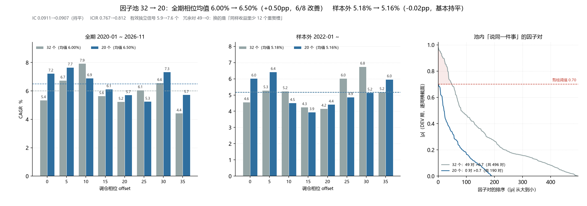

# 因子池去冗余与 20 因子落地（2026-11-03）

> 执行顺序：先做「删 R737/R738」（第一步），再做「34→20 + 每类 3 个」（第二步）。
> 两步之间挖出了本次最重要的问题：**相关性剪枝（`corr_max=0.70`）从上线起就没生效过**。

---

## 1. 一句话结论

删掉 2 个镜像因子、把池子从 34 收到 20 之后：

- **结构**：池内 |ρ|>0.7 的冗余对从 **49 对降到 0 对**，有效独立信号 **5.9 → 7.6 个**，ICIR 0.767 → 0.812，IC 持平（0.0911 → 0.0907）。
- **全期**（8 个相位）：均值 6.00% → **6.50%**（+0.50pp，6/8 改善），最差相位 4.43% → **5.26%**，离散度 1.08 → 0.90pp。
- **样本外**（2022+，同样 8 个相位）：5.18% → **5.16%**（−0.02pp，持平）。
- **诚实结论**：收益上没有可证实的增益，**换来的是「同样的收益里少 12 个重复槽」**。全期那 +0.50pp 基本来自 2020-2021，样本外是平的。

---

## 2. 直接原因：`corr_max=0.70` 从来没有触发过

### 2.1 症状

R737（rsi）与 R738（rsi_reversal）是**逐周 ρ = −1.0000 的镜像对**（147 周全部 −1.000），权重一正一负、均值 ±0.0095，等于白占两个槽。

`select_pool` 里有 `corr_max=0.70` 的剪枝逻辑，理论上第二个必须被拒。但：

| 口径 | R737 × R738 | 池内平均 \|ρ\| | \|ρ\|>0.7 对数 | \|ρ\|>0.9 对数 |
|---|---|---|---|
| 现网算法 | **−0.079** | 0.023 | **0** | 0 |
| 正确算法 | **−0.9995** | 0.298 | **60** | 19 |

阈值 0.70 对着一个最高只有 0.08 的矩阵，**永远不可能触发**。

### 2.2 根因

```python
# 旧：Σ_周 Σ_股 z_i·z_j  ÷  (mean_n_i · mean_n_j)
corr = G / (cnt[:, None] * cnt[None, :])
```

特征已是「逐周横截面 z-score」，`Σ z_i z_j` 的量级是 `周数 × 平均股票数 × ρ`；分母却只有 `平均股票数²`。等价于**少除了周数 T（147）、又多除了一个平均股票数（~3000）**，把 |ρ|=1 压成 0.008 量级。

```python
# 新：除以「逐周有效交集」的总数
corr = np.clip(G / np.maximum(J, 1.0), -1, 1)   # J = Σ_周 |valid_i ∩ valid_j|
```

### 2.3 为什么镜像对能一直待在池里：缓冲机制绕过了剪枝

`pool_guard` 的两条路径都不过相关剪枝：

1. **保留上次池**：`pool_prev` 里的因子直接进 `new_pool`；
2. **补足到目标规模**：从 `ranked` 里挑（`ranked = 本次选中 + 其余按 |ICIR| 排序的候选`，后一段根本没经过剪枝）。

本次重训的日志可以印证——剪枝前选出的 34 个里**没有 Oscillator 这一族**，而最终池里有 R737/R738（类别 Oscillator），说明它们是缓冲"补"进来的：

```
[pool] 候选 120，选中 34；类别分布: {Price Volume: 4, Turnover: 4, Volatility: 4, Pattern: 4,
      Breakout: 4, Momentum: 4, Momentum-extra: 3, Trend: 3, Reversal: 2, Distribution: 2}
[pool-guard] 保留 30 | 新增 4 | 移除 4 | 换手 8
```

`new_pool` 里的 34 个之后只重施了「类别配额」，没有重施「相关性」——所以 60 对冗余对能长期共存。

### 2.4 修法（`qf/model.py`）

1. **相关矩阵归一化**：改为按「逐周有效交集」归一（新增 `J` 累加，内存只多一个 block 的 bool 掩码）。
2. **抽取 `_corr_ok(k, chosen)`**：贪心选池与缓冲组装共用同一判定；不在前 120 候选里（无法判定）→ 放行，保持原行为。
3. **缓冲组装重施相关性约束**：类别配额之后再过一遍相关性；若候选全撞相关，先放宽相关性保规模（有兜底，池子不会缩水）。

新增 `tests/test_pool_corr_filter.py`（6 项，合成数据端到端）：
镜像对只能进 1 个、完全复制只能进 1 个、独立因子不被误剪、0.85ρ 在阈值 0.70/0.95 下分别进 1/2 个、**缓冲路径也必须剪掉镜像对**、源码级防线（旧归一化不许回来）。

---

## 3. 第一步：删掉 R737/R738（34 → 32）

做法：把这两个键从池里摘掉（不补人），重估权重；同时清掉它们在 `_pool_guard_state.json` 里的 streak，避免下次重估被"提拔"回来。

| 指标 | 34 个 | 32 个 |
|---|---|---|
| 复合分 IC | 0.0908 | 0.0911 |
| ICIR | 0.783 | 0.767 |
| t | 14.18 | 13.90 |
| 逐周 IC 与上一版相关 | — | **0.9989** |
| 相位均值 / 最差 | 5.97% / 3.85% | **6.00% / 4.43%** |
| 相位离散度 | 1.29pp | **1.08pp** |
| 生产相位（offset=10） | 7.33% | **7.93%** |

同相位配对：均值 **+0.03pp**、胜率 50%（4/8）、标准差 0.58pp。**收益上是硬币正反面，风险上更好**（离散度和最差相位都改善）——与"两个权重互相抵消的镜像因子，删了不影响决策"的判断一致，逐周 IC 相关 0.9989 就是证据。

---

## 4. 第二步：34 → 20（每类 ≤3 + 相关性真生效）

### 4.1 新池（20 个，9 个族）

| 因子 | 含义 | 类别 | 权重（最近一次） |
|---|---|---|---|
| risk-pattern:R610 | 10 日平滑实现波动率 | Volatility | −0.1296 |
| newf-extra:N001 | 5 日换手率 | Turnover | −0.1228 |
| momentum-extra:M001 | 20 日动量 | Momentum-extra | −0.1224 |
| newf-extra:N004 | 换手率不稳定度 | Turnover | −0.0772 |
| risk-pattern:R742 | 10 日量能确认实现波动率 | Volatility | −0.0682 |
| risk-pattern:R215 | 5 日量能确认下行波动率 | Volatility | −0.0616 |
| volume-stat:R485 | 7 日量能确认量价相关 | Price Volume | −0.0607 |
| directional:R208 | 5 日量能确认下轨跌破 | Breakout | +0.0496 |
| volume-stat:R188 | 5 日稳定度缩放量价相关 | Price Volume | −0.0493 |
| risk-pattern:R223 | 5 日量能确认缺口累积 | Pattern | +0.0460 |
| risk-pattern:R620 | 10 日平滑日内收益 | Pattern | −0.0446 |
| risk-pattern:R355 | 7 日平滑缺口累积 | Pattern | +0.0369 |
| volume-stat:R716 | 10 日稳定度缩放量价相关 | Price Volume | −0.0283 |
| newf-extra:N005 | 换手率加速 | Turnover | −0.0280 |
| volume-stat:R626 | 10 日平滑收益偏度 | Distribution | −0.0253 |
| directional:R794 | 14 日标准化跳期收益动量 | Momentum | +0.0170 |
| directional:R679 | 10 日波动缩放趋势效率 | Trend | +0.0131 |
| directional:R728 | 10 日量能确认跳期收益动量 | Momentum | −0.0098 |
| momentum-extra:M005 | 20 日动量（跳过近 5 日） | Momentum-extra | −0.0096 |
| directional:R604 | 10 日平滑下轨跌破 | Breakout | 0.0000（被权重地板置零） |

族分布：Volatility 3 / Turnover 3 / Price Volume 3 / Pattern 3 / Momentum 2 / Breakout 2 / Momentum-extra 2 / Distribution 1 / Trend 1。
`directional:*` 从 14 个缩到 4 个，`R737/R738/R758` 全部出池。

### 4.2 结构：冗余对清零

| 指标 | 32 个 | 20 个 |
|---|---|---|
| 池内两两平均 \|ρ\| | 0.285 | **0.231** |
| \|ρ\|>0.7 的对数 | 49 | **0** |
| \|ρ\|>0.9 的对数 | 16 | **0** |
| 最大 \|ρ\| | 0.977 | **0.698**（刚好压在阈值下） |
| 主成分（特征值>1） | 7 | 6 |
| 有效独立信号（参与率） | 5.9 | **7.6** |

**12 个槽换来了 +1.7 个真正独立的信号**——这是本次最硬的一项改善。

### 4.3 绩效：全期改善、样本外持平

| 指标 | 32 个 | 20 个 |
|---|---|---|
| 复合分 IC | 0.0911 | 0.0907 |
| ICIR | 0.767 | **0.812** |
| t | 13.90 | **14.71** |
| 相位 CAGR 均值（全期） | 6.00% | **6.50%** |
| 相位中位（全期） | 5.86% | **6.52%** |
| 最差相位（全期） | 4.43% | **5.26%** |
| 相位离散度（全期） | 1.08pp | **0.90pp** |
| Sharpe 均值 | 0.492 | **0.531** |
| 相位 CAGR 均值（**样本外 2022+**） | **5.18%** | 5.16% |
| 相位中位（样本外） | **5.21%** | 5.01% |
| 最差相位（样本外） | **4.16%** | 3.94% |

全期同相位配对：**+0.50pp、6/8 改善、t=1.43**（不显著）。

样本外**没有增益**（−0.02pp，中位与最差相位还略低）。也就是说全期那 +0.50pp 基本落在 2020-2021 的验证期里，**不能算作可外推的 alpha**。

另外注意：生产相位（offset=10）在旧池里是**最优档**（7.93%，0 个相位比它好），在新池里排第 4/8（6.91%，3 个更好）。所以单看"主页那个数字"会从 7.93% 掉到 6.91%，但分布口径是变好的——这正是上一轮把披露口径改成相位带的原因。



---

## 5. 顺带抓到的第二个 bug：动量面板过期 + 补 NaN 掩盖

20 个的池里第一次进了 `momentum-extra:M001/M005`，重训后一致性检测立刻报错：

```
❌ 模型 wf_h10: 2441 行，最后打分行 2426，滞后 14 日
```

原因链：

1. `build/factors/momentum_extra.npz` 是 10-21 建的，只有 **475 周**，而 `weekly_meta` 现在是 **477 周**（面板过期 2 周）。
2. 上一轮为了修"24 个扩展因子被静默丢弃"，加了 `align_panel_rows`：**尾部补 NaN** 对齐。
3. 于是这两个因子在最近 2 周全是 NaN → 复合分整行 NaN → 模型"最后打分行"停在两周前。
4. 更糟的是 `verify` 只在滞后 >5 日时才报错，而模型/回测/组合各阶段都"成功"，只有一致性检测兜住了。

修法：

- 重建 `momentum_extra`（`scripts/build_momentum_extra.py`，477 周）——历史 475 周与旧版最大差 1.9e-06（float32 舍入），确认同源。
- `qf/factors.py:align_panel_rows` 补 NaN 时**打印告警**："该族面板已过期，请重建"——补 NaN 只是形状对齐，不能当数据用。

修完后模型最后打分行 2436（滞后 4 日，正常），一致性检测通过。

---

## 6. 现状与回滚

- 生产模型 `wf_h10`：**20 个因子**、每类 ≤3、池内 |ρ|≤0.70；信号已按新池重算，一致性检测 ✓。
- 备份：
  - `build/models/wf_h10_bak_drop2pre`：34 个（删 R737/R738 之前）
  - `build/models/wf_drop2`：32 个（删掉镜像对、未去冗余）
  - `build/models/_pool_guard_state_bak_drop2pre.json`：缓冲状态
- 回滚到 32 个（一条命令）：

```bash
python scripts/run_research.py --out build/models/wf_h10 --method blend \
  --max-factors 34 --horizon 10 --no-fundamental \
  --extra build/factors/newf_turnover_extra.npz \
  --pool-guard --pool-streak 2 --pool-from build/models/wf_drop2
python scripts/run_pipeline.py --only backtest,phase_band
python scripts/run_pipeline.py --from etf
```

风险披露：

1. **样本外没有增益**。20 个版本的收益优势只体现在 2020-2021；保留它的理由是"同样的收益下冗余更少、ICIR 更高、参数少 12 个"，不是"收益更高"。
2. **风格集中度略降但仍偏高**：Volatility 3 + Turnover 3 + Price Volume 3 = 9/20，本质仍是"低波 + 低换手 + 量价"三件事，2020-2026 恰好是这三件事占优的六年。
3. **单相位数字会变难看**（7.93% → 6.91%）。对外必须报相位中位/区间：**中位 6.52%、均值 6.50%、区间 5.26%~7.66%**。
4. `directional:R604` 权重被地板置零，但仍占一个槽——下一次重训可以再收一格（19 个），不过影响极小，留给缓冲区。

---

## 7. 验证与产物

- 新增测试：`tests/test_pool_corr_filter.py`（6 项，含缓冲路径与源码级防线）。
- 相关回归：`test_extra_catalog_dedup / test_phase_band / test_newf_live / test_newf_extra / test_audit_model / test_backtest / test_consistency`。
- 全链路：`--only backtest,phase_band` + `--from etf` 跑通，`verify` ✓（数据/因子/模型/信号/报告全部对齐）。
- 新增/更新产物：
  - `build/eval/phase_band_drop2.json`（32 个）、`phase_band.json`（20 个，生产）
  - `build/eval/phase_band_{drop2,h10}_oos.json`（2022+ 相位带）
  - `build/runs/exp_drop2`（32 个的对照回测）
  - `build/models/{wf_drop2, wf_prod20}`、`build/models/wf_h10`（生产，20 个）
  - `build/eval/pool_dev_corr.json`（相关性审计基线）
  - `scripts/plot_pool20_landing.py`、`reports/shots/因子池_32到20相位对比.png`
  - `build/eval_pool_dev_corr.py`（DEV 期相关性审计脚本）
