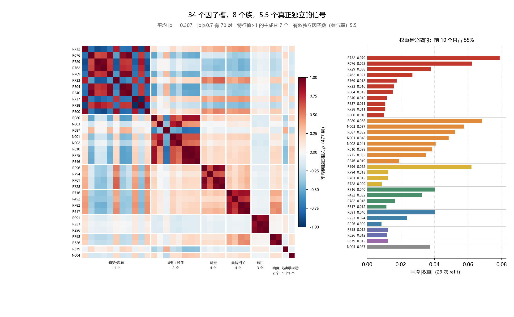
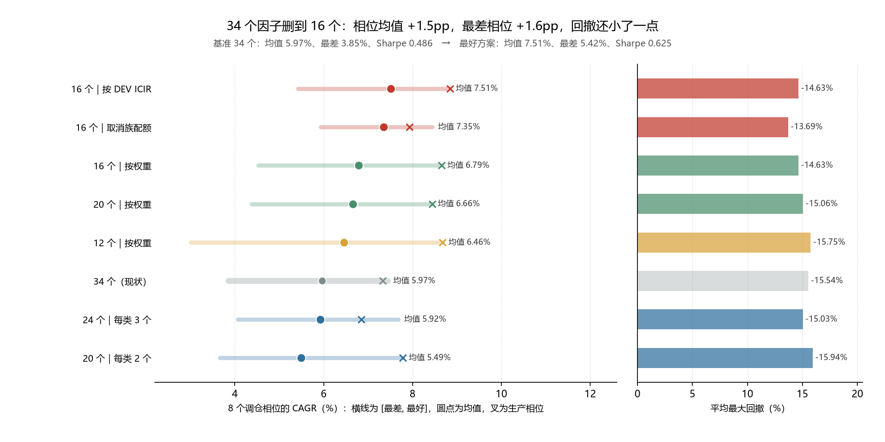

# 因子池精简评估：34 个里有 18 个是负担

> 2026-11-03 · 数据至 2026-10-27 · 模型 wf_h10（40 只等权 / 40 日调仓）
> 全部结论用 **8 个调仓相位配对** 评估，不用单点回测

## 0. 一句话结论

**34 个槽位里有 18 个可以删掉，删掉后相位均值从 5.97% 涨到 7.35%~7.51%，最差相位从 3.85% 抬到 5.42%~5.93%，回撤还小了一点。**
但这不是"越少越好"——12 个就开始变差，而且 16 个版本把赌注压在了一个风格上，风险性质变了。

---

## 1. 先看结构：34 个槽，8 个族，5.5 个独立信号

用 477 周的逐周横截面相关做层次聚类（距离 = 1-|ρ|）：

| 指标 | 数值 | 含义 |
|---|---|---|
| 平均 \|ρ\| | 0.307 | 34 个之间的平均相关 |
| \|ρ\| ≥ 0.7 的对数 | 70 | 总 561 对里占 12.5% |
| 特征值 > 1 的主成分 | 7 个 | 大部分信息集中在 7 个方向 |
| **有效独立因子数**（特征值参与率） | **5.5 / 34** | 34 个槽只提供了 5.5 个独立信号 |
| 聚类族数（1-\|ρ\| ≤ 0.5） | 8 个 | |

八个族：

| 族 | 槽位数 | 族内最大 \|ρ\| | 内容 |
|---|---|---|---|
| 趋势 / 反转 / 突破 | 11 | 1.000 | directional 系列（R076/R340/R596/R600/R604/R679/R728…） |
| 波动率 + 换手 | 8 | 0.981 | ATR 占比、实现波动率、换手率挤在同一族 |
| 跳空动量 | 4 | 0.953 | 跳期收益动量 4 个窗口 |
| 量价相关 | 4 | 0.961 | 量价相关 4 个窗口 |
| 缺口累积 | 3 | 0.966 | 缺口累积 3 个变体 |
| 收益偏度 | 2 | 0.917 | R758 / R626 |
| 趋势效率 | 1 | — | R679 |
| 换手不稳定 | 1 | — | N004 |

注意第二行：**换手率与实现波动率的相关系数高达 0.98**。上一轮加的换手族，本质上是给"波动率"换了个测法——这也解释了它为什么能通过双准则却又不改变有效独立数。

---

## 2. 谁是真的多余：单删测试

对每个因子，冻结其余 33 个的权重和整条打分流水线，只剔除它一个，看复合分 OOS IC 怎么变：

- **34 个里 22 个的剔除影响在 ±0.0002 以内**（噪声级）
- **15 个剔除后 IC 反而上升**
- 影响最大的是 R080（5 日平滑 ATR 占比，−0.0017），最小的是 R596（+0.0007）

没有任何一个因子是"必须的"。这是族内高度同质的直接证据：删掉任何一个，同族还有 3~7 个在说同一件事。

---

## 3. 精简实测：8 个方案，全部用相位带评估

每格都是 8 个对齐调仓相位的统计，不是单点回测。

| 方案 | 因子数 | OOS IC | ICIR | 相位 CAGR 均值 | 中位 | **最差** | 最好 | 平均 MaxDD | Sharpe |
|---|---|---|---|---|---|---|---|---|---|
| **34 个（现状）** | 34 | 0.0908 | 0.783 | 5.97% | 5.99% | **3.85%** | 7.44% | −15.54% | 0.486 |
| 24 个（每类 3 个） | 24 | 0.0903 | 0.760 | 5.92% | 6.40% | 4.07% | 7.68% | −15.03% | 0.481 |
| 20 个（每类 2 个） | 20 | 0.0890 | **0.784** | 5.49% | 5.44% | 3.67% | 7.79% | −15.94% | 0.433 |
| 20 个（按 \|w\|） | 20 | 0.0934 | 0.740 | 6.66% | 6.54% | 4.37% | 8.44% | −15.06% | 0.554 |
| 16 个（按 \|w\|） | 16 | 0.0933 | 0.731 | 6.79% | 6.77% | 4.52% | 8.65% | −14.63% | 0.563 |
| 12 个（按 \|w\|） | 12 | 0.0932 | 0.704 | 6.46% | 6.91% | 3.01% | 8.68% | −15.75% | 0.524 |
| **16 个（按 DEV ICIR）** | 16 | 0.0910 | 0.684 | **7.51%** | 7.72% | **5.42%** | 8.84% | −14.63% | **0.625** |
| **16 个（取消族配额）** | 16 | 0.0913 | 0.683 | 7.35% | 7.65% | **5.93%** | 8.44% | **−13.69%** | 0.621 |
| 12 个（重新选池） | 12 | 0.0903 | 0.675 | — | — | — | — | — | — |

### 三条独立路径收敛到同一个答案

| 路径 | 怎么选 | 结果 | 与"取消配额"的重叠 |
|---|---|---|---|
| 按 `\|w\|` 截断 | 用 23 次 refit 的平均权重（**有前视**） | 6.79% | 13/16 |
| 按 DEV ICIR | 只用 2017-2019 的单因子 ICIR（无前视） | 7.51% | 13/16 |
| 取消族配额 | 改超参 `--max-factors 16 --max-per-category 16` 重选池（无前视） | 7.35% | — |

后两条完全无前视，且互相重叠 13/16。**被淘汰的 18 个，三条路径给出的名单完全一致**：

- `directional:*` 系列 14 个（趋势/反转/突破/跳空动量）
- `R737` / `R738` 2 个（ρ = 1.000 的镜像对，权重 +0.0107/−0.0107 互相抵消）
- `R758` / `R626` 2 个（收益偏度，权重合计 2.4%，DEV |ICIR| 全池最低）

34 − 18 = 16，正好是两个最优方案的规模。

---

## 4. 效果从哪里来：两个独立因素，各贡献一半

| 动作 | 相位均值 | 增量 |
|---|---|---|
| 34 个（基准） | 5.97% | — |
| → 24 个（每类 3 个，温和减量） | 5.92% | −0.05pp（没变） |
| → 20 / 16 个（按权重，保留族结构） | 6.66% / 6.79% | **+0.7~0.8pp** |
| → 16 个（把 directional 清空） | 7.35~7.51% | **再 +0.6~0.7pp** |

**关键的分解在这里**：单纯减少数量（34→24，或每类配额收紧到 2 个）几乎没用，甚至变差（5.49%）。真正的增量全部来自"**把 directional 整块清掉**"。

为什么？因为 directional 那 14 个在 DEV 期的 |ICIR| 只有 0.23~0.50，全池排在 17~34 名。它们能进池**不是因为信号强，而是因为"每类 4 个"的配额强行给 Trend / Breakout / Momentum / Reversal / Oscillator 各留了位置**。配额机制的初衷是防止过拟合（不押注单一族），但在 DEV 期数据上，这几类的因子就是弱的。

---

## 5. 一个反直觉的发现：ICIR 在这个策略里是误导指标

看这两行的对比：

| 方案 | ICIR | 相位 CAGR 均值 |
|---|---|---|
| 20 个（每类 2 个） | **0.784（最高）** | **5.49%（最低）** |
| 16 个（无配额） | 0.683（最低） | 7.35%（次高） |

ICIR 最高的方案收益最差。原因是：

- **ICIR 衡量"信号稳不稳"，CAGR 衡量"信号够不够锐"**。删掉长尾因子后，合成分少了平滑，周度 IC 波动变大（ICIR 掉），但选股排序更极端、更像"单一大信号"（CAGR 涨）。
- 在 40 只等权组合里，**排序锐利度直接决定选出来的是"最好的 40 只"还是"平均的 40 只"**。

所以过去用 ICIR 判断"因子池好不好"是有偏的。这也解释了为什么 34 个方案 IC 只有 0.0908，却和 16 个方案 0.0913 打平——预测精度几乎没变，变的是持仓结构。

---

## 6. 代价：16 个版本押注在一个风格上

必须说清楚这一点，否则上面的数字会骗人。

16 个版本的构成（nocap16）：

| 类目 | 个数 | 对应族 |
|---|---|---|
| Price Volume（量价相关） | 6 | 族6 |
| Volatility（实现波动率 / ATR） | 5 | 族2 |
| Turnover（换手率） | 3 | 族2 |
| Pattern（缺口累积 / 上影线） | 2 | 族1 + 族2 |

**16 个槽只落在 3 个族里，有效独立信号从 5.5 个降到 2~3 个。**

这意味着：

1. 回测期内（2020-2026）A 股恰好是**低波动 + 低换手 + 量价背离占优**的六年（尤其 2024 微盘崩盘之后）。这套池子吃到了这个风格 beta。
2. 一旦风格切到高波/高换手（2014-2015 式普涨、2020 成长股行情），这 16 个因子会同时失效——**没有对冲**。
3. 34 个版本虽然平庸（5.97%），但它的 1.4pp 差距本质是"用收益换了风格的分散保险"。8 相位检验只能排除"日历运气"，**排除不了"风格集中"**。

---

## 7. 建议（按风险从低到高）

| 级别 | 动作 | 预期 | 风险 |
|---|---|---|---|
| **① 立即可做** | 删 `R737` + `R738` | IC 不变（0.0850→0.0849），少 2 个槽、少 1 对 ρ=1.000 的镜像 | 零 |
| **② 建议做** | `--max-factors 34→20`，`--max-per-category 4→3`；即取消 directional 的配额保护，但保留少数代表 | 相位均值 +0.7pp 量级 | 低 |
| **③ 可选** | 采用 `16 个 + 取消族配额`（nocap16） | 均值 7.35%，最差 5.93%，MaxDD −13.69%（三者都是最优） | 中：风格集中 |
| **④ 不建议** | 一步到 12 个 | 均值反而回落到 6.46%，最差相位掉到 3.01% | 高 |
| **⑤ 真正的下一步** | 与其继续删，不如**换维度**：`bp`（估值，ΔIC +0.0070）、`on_minus_intra20`（隔夜减日内）做成独立腿 | 独立信号数从 3 回到 5+ | — |

第 ⑤ 条的理由：现在的 16 个已经榨干了"量价"这一块的信息。继续在量价里挑，只会越来越集中；要提升只能引入新的信息源。而 `bp` 目前因为 `--no-fundamental` 被关在门外，`on_minus_intra20` 在 newf 族里但从未参选。

---

## 8. 本次顺带修的两处

1. **`run_research.py` catalog 合并去重**：`newf-extra` 的 N001~N005 与 `newf-turnover` 是同一批因子的两份副本，`panels` 字典天然去重但 `catalog` 直接 concat 会留重复行。若某天同时传两个 `--extra`，按类配额计数会算错。已加 `drop_duplicates(subset="factor_key")` + 重名告警，并补 `tests/test_extra_catalog_dedup.py`（4 项）。
2. **新增 `--max-per-category` 参数**：原来 `ModelConfig.max_per_category=4` 写死、命令行改不了，"配额是否拖后腿"根本无法验证。默认值保持 4，不改变生产行为。

---

## 9. 方法与口径

- 相关矩阵：477 周逐周横截面相关（因子已做 rank-z + 行业/市值中性化）的平均，股票域为当周全因子可用的 2934 只。
- 单删测试 / 子集评估：冻结 `model_weights.parquet` 的历史权重，只改参与打分的因子子集，其余流水线（中性化 → 截面 z → 0.6 时序平滑 → Rank IC）与原模型完全一致。这是**上界估计**——真正重估权重后保留因子会自动补偿。
- 正式实验：`run_research.py` 重跑 walk-forward（23 次 refit）+ `phase_band.py` 跑 8 个对齐相位（offset = 0,5,10,…,35，均与周频打分行对齐）。
- OOS IC 口径统一为 2020-01 起 328 周；相位带区间 2020-01 ~ 2026-10。
- 所有精简方案均**未改动生产模型** `build/models/wf_h10`，实验产物在 `wf_slim*` / `wf_dev16` / `wf_nocap16` / `wf_cap2_20` / `wf_cap3_24` / `wf_rs12`。

> 历史回测不代表未来表现；本系统仅供量化研究，不构成投资建议。
