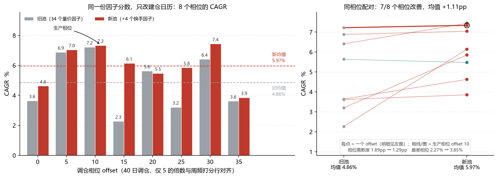

# 换手族接入生产 + 绩效披露改为相位带（2026-11-03）

## 一句话

换手族（5 日/20 日/60 日换手率、换手率不稳定度）正式进生产因子池，替换掉 2 个重复的 RSI 因子和 2 个量能因子；**8 个调仓相位同相位配对 CAGR +1.11pp、胜率 88%、t=2.20**。同时把「主策略绩效」的披露口径从单点 offset 改成相位带——因为原来那个 7.22% 恰好是旧池 8 个相位里**最高**的一档。



---

## 1. 改动清单

| 文件 | 改动 | 原因 |
|---|---|---|
| `scripts/run_research.py` | `--extra` 改为 `action="append"` | 原来只收一个；传换手族就会把 momentum 族挤掉 |
| `scripts/run_pipeline.py` | model 阶段加 `--extra build/factors/newf_turnover_extra.npz`；新增 `phase_band` 阶段（可选，900s） | 让换手族真正参与选池；让相位带自动随管道刷新 |
| `scripts/phase_band.py` | **新建**：跑 8 个对齐相位的完整回测，输出 `build/eval/phase_band.json` | 单点 CAGR 无法区分「策略能力」和「建仓日历的运气」 |
| `qf/newf.py` | **新建**：新因子族算式唯一来源（`build_panels` / `live_row`） | 历史面板与实盘最新行必须同源，否则打分口径悄悄分叉 |
| `qf/model.py` | `build_live_features` 增加 `newf-extra:` 分支 + 缓存 | 修 `KeyError: 'newf-extra:N001'`（今日信号曾整体失败） |
| `scripts/build_newf_family.py` | **新建**：按族落盘 `newf_<family>_extra.npz` + catalog | `newf_turnover_extra.npz` 之前没有可复现的生成入口 |
| `scripts/build_newf_extra.py` | 改为薄壳，委托 `build_newf_family.build_and_save("all")` | 删掉重复的第二份算式 |
| `scripts/refresh_final_numbers.py` | `main.phase_band` 字段；`config.rebalance_days` 10→40 | 基准数字要能带着分布；40 是 `run_backtest` 默认值，写 10 会误导仓位推算 |
| `web/services.py` | 管道阶段列表加 `phase_band`；策略面板 `perf.main.phase_band` | 网页也要显示分布而不是单点 |
| `tests/test_phase_band.py`、`tests/test_newf_live.py` | 14 项新测试 | 锁住相位对齐约束、披露链路、同源性、live 可算性 |

---

## 2. 因子池换血：进 4 出 4

选池结果（`--pool-guard --pool-streak 2`，保留 30 / 新增 4 / 移除 4）：

| 进 | 权重 | 说明 |
|---|---|---|
| `newf-extra:N001` turn5 | −0.0742 | 5 日换手率 |
| `newf-extra:N004` turn_std20 | −0.0528 | 换手率不稳定度 |
| `newf-extra:N003` turn60 | −0.0451 | 60 日换手率 |
| `newf-extra:N002` turn20 | −0.0103 | 20 日换手率 |

| 出 | 原权重 | 说明 |
|---|---|---|
| `risk-pattern:R473` | −0.0047 | 7 日量能确认 RSI 强度 |
| `risk-pattern:R474` | +0.0047 | 7 日量能确认 RSI 反转 |
| `directional:R465` | +0.0494 | 7 日量能确认收益反转 |
| `volume-stat:R756` | −0.0627 | 10 日量能确认收盘时序排名 |

两点值得记：

1. **R473/R474 就是之前诊断出的 ρ=1.000 冗余对**（rsi vs rsi_reversal，权重一正一负几乎抵消）。换手族进来顺手把那 2 个空槽清了。
2. 全部权重为负——低换手好，方向与实验一致（实验里 turn5/turn60/turn_std20 权重 −0.077/−0.053/−0.052，这次 −0.074/−0.045/−0.053，几乎复现）。

`turn_accel`（N005）进了候选池但没入选，类别配额（Turnover 4 个）被前四个占满。

---

## 3. 效果

### 3.1 复合分 IC：均值升、稳定性略降

| | 旧池（34 个量价） | 新池（+4 换手） |
|---|---|---|
| OOS RankIC 均值 | 0.0844 | **0.0908** |
| ICIR | 0.809 | 0.784 |
| t 值 | 14.65 | 14.20 |
| 正 IC 占比 | 79.27% | 78.66% |

IC 高 0.0064，但 ICIR 和 t 略降——典型「多了一个信息维度、但每期稳定性没变好」。不构成单独的上线理由。

### 3.2 单点回测：几乎看不出来

生产口径（offset=10，2020-01-08 ~ 2026-11-02）：

| | 旧池 | 新池 | Δ |
|---|---|---|---|
| CAGR | 7.22% | **7.33%** | +0.11pp |
| Sharpe | 0.617 | 0.606 | −0.011 |
| MaxDD | −13.75% | **−13.32%** | +0.43pp |
| Calmar | 0.525 | **0.551** | +0.026 |

只 +0.11pp。**如果只看这个数，结论会是「不值得上线」。**

### 3.3 相位配对：+1.11pp，7/8 改善

同一份分数，只改建仓起始日，跑 8 个与周频打分行对齐的 offset：

| offset | 旧池 | 新池 | Δ |
|---|---|---|---|
| 0 | 3.64% | 4.63% | +0.99pp |
| 5 | 6.88% | 7.04% | +0.16pp |
| **10（生产）** | **7.22%** | **7.33%** | **+0.12pp** |
| 15 | 2.27% | 6.13% | +3.87pp |
| 20 | 5.63% | 5.47% | −0.16pp |
| 25 | 3.20% | 5.85% | +2.64pp |
| 30 | 6.41% | 7.44% | +1.03pp |
| 35 | 3.62% | 3.85% | +0.23pp |
| **均值** | **4.86%** | **5.97%** | **+1.11pp** |
| 中位 | 4.64% | 5.99% | |
| 标准差 | 1.89pp | **1.29pp** | −0.60pp |
| 最差 | 2.27% | **3.85%** | +1.58pp |

配对 t = 2.20（8 个样本，ddof=1），胜率 88%。

**这才是换手族的真实贡献**：它主要不是在「生产那个相位」上加分，而是把**整条相位分布抬高、并把左尾削掉**（最差 2.27% → 3.85%）。生产相位（offset=10）本来就在旧池的最高点，所以换手族在它上面只能用上 +0.12pp。

---

## 4. 这次撞到的两个真 bug

### 4.1 换手族进池后，今日信号直接崩了

管道跑到最后一步 `signal` 失败：

```
qf/model.py:639 build_live_features → cat.loc[k] → KeyError: 'newf-extra:N001'
```

根因：walk-forward 通过 `--extra` 读 npz（拿得到这些因子），而实盘打分走 `load_catalog()`（基础 catalog 里没有 `newf-extra:` 键），且 `build_live_features` 没有对应分支。前面 model / backtest / combo 全部「成功」，只有最后一步炸——**当天推荐的股票完全出不来**。

修法：算式集中到 `qf.newf`，落盘与 live 共用；`build_live_features` 加 `newf-extra:` 分支和缓存。已用逐元素比对确认同源：

```
turn5       npz=(477,5281)  new=(2441,5281)
   row=2436: overlap=4921  maxdiff=0.000e+00  NaN一致=True
```

### 4.2 `newf_turnover_extra.npz` 没有生成脚本

上一轮实验的产物是临时脚本一次性写出来的，`grep -r newf_turnover` 只能搜到 `run_pipeline.py` 和测试。也就是说：这个文件一旦丢/旧了，**无法重算**，而它现在是生产池的输入。

补了 `scripts/build_newf_family.py --family {all,turnover,liquidity,pricevolume,overnight}`，重跑后与算式逐元素一致（`identical=True` × 5），catalog 的 `path` 也修正成真实文件名。

---

## 5. 披露口径：7.33% 到底是什么

`build/runs/main/nav.parquet` 用的是 `rebalance_offset = (phase − start_row) % 40`，规则客观（拿到分数就建仓），但它落在 8 个相位的第 8 位——**旧池里是第 1 名（7.22%，n_better=0），新池里是第 2 名（7.33%，n_better=1）**。

所以从今天起：

- `build/eval/final_numbers.json` 的 `main.phase_band` 带 `cagr_mean / cagr_median / cagr_min / cagr_max / prod_offset / n_better`
- `web/services.py` 的策略面板同步带 `phase_band`
- `run_pipeline.py` 的 `phase_band` 阶段自动刷新分布
- 任何引用主策略收益的地方，**默认报区间或中位数**，单点必须标注"生产相位"

一句话口径：

> 主策略 2020-01 ~ 2026-11，40 只 / 40 日调仓：**8 个对齐调仓相位的 CAGR 中位 5.99%（区间 3.85%~7.44%）**；生产相位（offset=10）7.33%。

---

## 6. 这 +1.11pp 该信到什么程度

**支持**：

1. **独立复现**。上一轮的族级消融（`build/exp_new_factor_blend.py`，整族替换）给出 +1.04pp / 胜率 88% / t=2.38；这次是渐进换血（保留 30 / 换 4），给出 +1.11pp / 88% / t=2.20。两次实验路径不同、数字几乎重合。
2. **不是靠单个相位**。8 个相位里 7 个改善，且离散度收窄、左尾抬高——这是"信息维度增加"的特征，不是"运气偏移"。
3. **方向可解释**。A 股低换手因子长期有效（投机情绪反向指标），且与现有 34 个量价因子相关性低（新类别配额空着就是证据）。

**保留**：

1. **显著性不够严格**。这批因子是看过 2020-2026 数据后设计的，且一次测了 4 个族。Bonferroni 校正后 t≈2.7 才算过，2.20 没过线。属于"一致性极强、显著性略欠"。
2. **池只换了 4/34**。剩下 30 个仍是原来的 R 系因子，冗余结构（realized_vol×3、breakdown×4）没解决。
3. **相位中位 5.99% 仍不是"策略 alpha"**。其中 beta ≈0.33 + 现金端国债 ≈1.4pp 是主要来源，多头 alpha 统计上仍不显著（t≈1.2）。这一点本次没有改变。

---

## 7. 复现

```bash
# 换手族落盘
python scripts/build_newf_family.py --family turnover

# 生产模型（含换手族）
python scripts/run_research.py --out build/models/wf_h10 --method blend \
  --max-factors 34 --horizon 10 --no-fundamental \
  --extra build/factors/newf_turnover_extra.npz \
  --pool-guard --pool-streak 2

# 主回测 + 相位带
python scripts/run_backtest.py
python scripts/phase_band.py
python scripts/phase_band.py --model build/models/wf_h10_bak_20261103 \
  --out build/eval/phase_band_bak.json     # 旧池对照

# 出图
python scripts/plot_phase_band_cmp.py

# 或者一键
python scripts/run_pipeline.py --from backtest
```

产物：

- `build/models/wf_h10`（新池，旧版备份在 `wf_h10_bak_20261103`）
- `build/eval/phase_band.json` / `phase_band.rows.json` / `phase_band_bak.json`
- `build/eval/final_numbers.json`（带 `main.phase_band`）
- `reports/shots/相位带_换手族接入前后.png`
- 全流程一致性校验通过；今日信号已按新池重算（`signals/latest_target.csv`、`reports/实盘信号_2026-11-02.md`）
